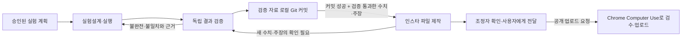

# 세 역할로 나눈 연구·콘텐츠 작업 방식

사용자가 제안한 역할은 실험설계·실행, 결과 검증, 인스타그램 게시물 작성의 세 가지다.
현재 이 chat에서는 이 역할을 담당하는 서브에이전트를 구성해 작업을 나눈다.
이는 이 chat 안의 협업 구성이다. 영구 무인 실행 시스템, 자동 스케줄러, 별도 Codex 맞춤
에이전트 등록을 구현했다는 뜻은 아니다. 기존 Python 실행기는 정해진 실험을 실행하는 도구이며,
서브에이전트가 chat 밖에서 계속 연구하도록 예약하는 시스템과는 구분한다.

## 역할과 조정자

| 역할 | 핵심 책임 | 다음 담당에게 넘기는 것 |
|---|---|---|
| [실험설계·실행](../agents/experiment.md) | 가설·비교 조건·예산을 고정하고 실행 | 계획, 변경 변수, 원본 run과 재현·복구 정보 |
| [결과 검증](../agents/results_review.md) | 수치·자료·비교 조건을 독립적으로 확인 | 검증 상태, 확인된 수치, 게시 가능한 주장과 근거 |
| [인스타 작성](../agents/instagram.md) | 검증된 내용을 카드·영상·캡션으로 제작 | 게시 파일, 출처 목록, 품질 확인 기록 |
| 조정자 | 승인 범위·예산·담당 파일·진행 순서를 관리 | 상태 보고, 단계 연결, 필요한 예외 판단 |

세 역할 외에 조정자는 기존 주 담당 에이전트가 맡는다. 실험 담당이 자기 결과의 유리한 해석을
확정하고 바로 게시물로 보내지 않도록 결과 검증을 독립된 단계로 둔다.

## 진행 순서와 인계 계약



1. **실행 전 고정**: 연구 질문, 가설, 기준 run, 변경할 변수 하나, 고정 조건, seed와 미로,
   평가·선택 기준, 시간·스텝·재시도 예산을 기록한다.
2. **실행 후 인계**: 원본을 보존하고 완료·실패 상태와 실제 사용량, 코드·설정·자료의 식별 정보를 넘긴다.
3. **독립 검증**: 검증 담당이 재계산·복원·조건 비교를 수행하고 통과/불완전/기각을 구분한다.
4. **게시물 제작**: 통과한 주장만 사용하고 수치의 출처와 조건을 보존한다. 새로운 성능 주장은 재검토한다.
5. **사용자에게 전달·업로드**: 조정자가 산출물과 핵심 결과를 연결해서 보여준다. 공개 업로드 요청이 있으면
   [인스타 역할 지침](../agents/instagram.md)의 Chrome Computer Use 절차에 따라 수행한다.

### 결과 검증 뒤 Git 커밋 훅

2번 역할인 결과 검증 담당의 작업이 끝나면, 조정자가 다음 명령을 실행한다.

```powershell
python scripts/commit_review.py --study studies/CNN-02/results
```

`review.json`이 있어야 실행된다. 해당 study에 존재하는 `protocol.json`, `comparison.json`,
`review.json`, `verified_facts.json`을 원본 그대로 `studies/<ID>/reviews/snapshots/<내용 해시>/`에 복사하고,
출처·검증 상태·SHA-256을 적은 `manifest.json`과 함께 로컬 Git 커밋에 보존한다.
원본 결과와 모델은 기존 위치에 유지한다. 통과하지 않은 검토도 실제 상태로 기록하며,
이 커밋만으로 게시물 제작이 허용되지는 않는다.

동일한 자료는 기존 커밋을 재사용한다. 다른 작업의 스테이징이 있으면 중단하며,
커밋 실패 시 콘텐츠 인계를 진행하지 않는다. 코드는 자동으로 일괄 커밋하지 않는다.
코드·설정 변경의 실험 전 복구 커밋은 기존 규칙대로 별도로 만든다. push는 수행하지 않는다.

`studies/CNN-02/scripts/export_study_content.py`는 두 검토 기록의 통과 상태, comparison/protocol 해시,
run ID를 검사한 뒤 이 훅을 자동 호출한다. 커밋 성공 뒤에만 출력 폴더를 만들고,
`provenance.json`에 `review_commit`을 기록한다. 다른 제작 도구나 직접 제작 시에는
조정자가 위 명령의 성공을 확인하고 커밋 해시를 콘텐츠 담당에게 넘긴다.
이는 역할 사이의 워크플로 훅이며 `.git/hooks`나 Codex 전역 설정을 변경하지 않는다.

이 문서는 인계에 필요한 정보와 책임을 정한다. 현재 실험에서는 검증 담당이 `review.json`과
`verified_facts.json`을 별도 파일로 작성한다. `studies/CNN-02/scripts/export_study_content.py`는 검증 상태와
원본 comparison/protocol의 해시가 일치할 때에만 게시물을 생성한다. 이 게이트 외에 전 과정의
자동 상태 전이, 자동 에이전트 호출, 데이터베이스나 메시지 큐를 구현한 것은 아니다.
protocol·config·metadata·원본 결과와 각 담당자의 검토 경로는 조정자가 연결한다.

## 독립성과 동시 작업

- 실행 중인 코드·설정은 담당자를 정하고, 다른 역할이 동시에 변경하지 않는다.
- 검증 담당은 원본을 고치지 않고 별도 검토 기록을 남긴다. 게시물 담당은 실험을 재선택하지 않는다.
- 병렬로 가능한 일은 분리한다. 예를 들어 실험 실행 중 역할 명세 작성이나 검증된 이전 결과의
  디자인 작업은 가능하지만, 미완료 실험의 최종 결론은 미리 만들지 않는다.
- 승인된 계획 안의 반복 실행·단계 전환·로컬 제작은 같은 사용자 확인을 반복하지 않고 진행한다.
- 승인 범위 밖의 새 계획이나 추가 예산은 실행 사실과 구분해 제안한다. 공개 업로드 허가는
  로컬 파일 제작 허가와 구분한다.
- 인스타그램 공개 업로드는 요청된 목적지와 범위 안에서 Chrome의 Computer Use로만 진행한다. 주소·계정·대상 게시물을
  확인할 수 없는 경우 작업을 중단하고 기존 게시물을 유지한다. 업로드 전 검수와 단일 정식 업로드본 유지 규칙은
  [인스타 역할 지침](../agents/instagram.md)을 따른다.
- 인스타 담당은 게시 전 초안과 최종본을 `studies/<주관 실험 ID>/exports/<게시물 ID>/`에 모은다. 게시 완료와 공개 검수 뒤에는
  회차별 작업 폴더와 중복 파일을 정리하고 `studies/<주관 실험 ID>/exports/<게시물 ID>.zip` 하나만 남긴다.

## 실험별 계획 확인

[실험 목록](experiment_index.md)에서 작업할 항목의 승인 상태와 프로토콜을 확인한다.
완료된 [4단계 실험](../studies/CNN-02/study_protocol.md)은 학습량 → 탐색 기간 → 학습률 → FC 너비 순서였으며,
C와 D의 기준은 앞선 검증 결과로 선택한다. 모든 단계가 바로 직전 단계와 비교되는 것은 아니다.
선택은 마지막 checkpoint의 검증 성공률 평균, 낮은 seed 표준편차, 성공 경로 효율 순이다.
완전 동률은 기존 조건을 유지한다. 최종 테스트는 사용하지 않는다.

훈련 return은 탐색을 포함하고, 성공률은 평가 정책과 미로에 따라 달라진다. 보상 곡선과
훈련 greedy·검증 greedy 성공률을 구분한다. 8개 개발 검증 미로를 반복 사용한 선택 결과를
더 넓은 미로 분포의 최종 성능으로 소개하지 않는다.

## 예산과 복구

예산은 실험별 프로토콜과 실행 설정에 기록한다. 실패 결과는 보존하며, 저장 오류 복구는
기록된 추가 재실행 예산 안에서 수행한다. 완료 seed를 재사용할 때에는 원본과 해시를 남긴다.
재시작한 학습과 중간 상태를 이어가는 resume를 구분한다. 코드 오류 수정은 학습 변수 변경과
별도로 기록하고, 실험 설계에 영향을 주면 새 비교가 필요한지 검증 담당이 확인한다.

향후 영구 무인 운영으로 확장하려면 누적 실제 스텝·시간·재시도 원장, 인계 형식 검증,
동시 실행 잠금, 재시작 가능한 상태 관리, 역할별 도구 범위와 종료·알림 정책을 별도로 구현해야 한다.
이는 후속 구현 항목이며 이 역할 문서만으로 제공되는 기능이 아니다.
